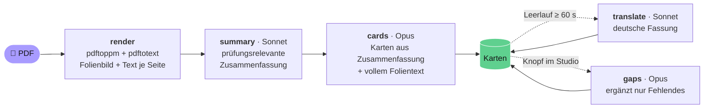
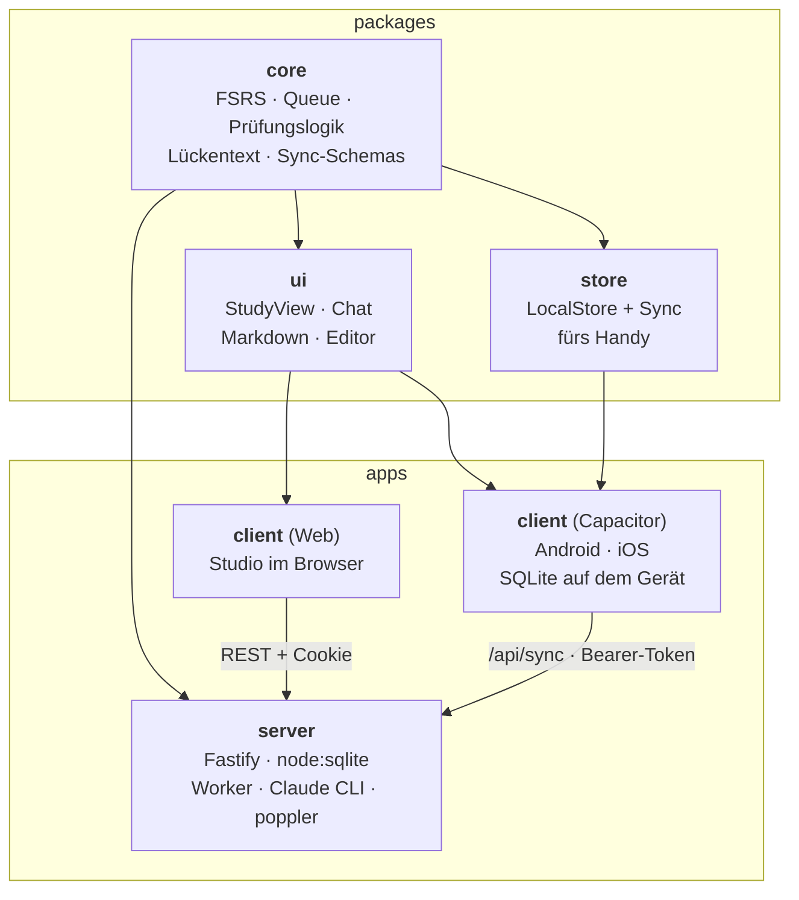
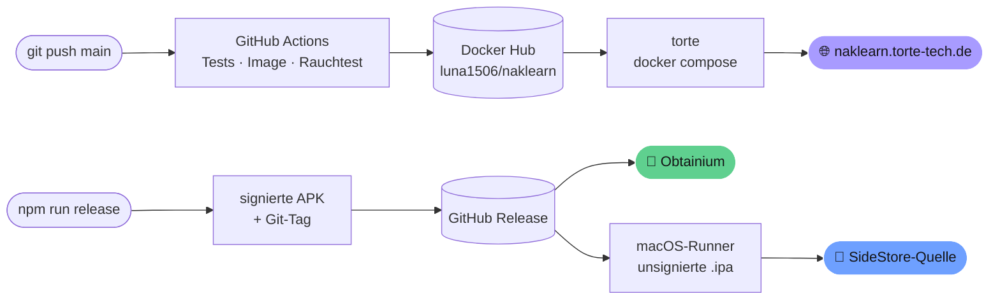

<p align="center">
  
</p>

<p align="center">
  <a href="https://naklearn.torte-tech.de"></a>
  <a href="https://github.com/Luna1506/naklearn/releases/latest"></a>
  <a href="https://github.com/Luna1506/naklearn/actions/workflows/deploy.yml"></a>
  <br>
  
  
  
  
  
  
</p>

<h3 align="center">PDF hochladen, Kaffee holen, lernen.</h3>

<p align="center">
  NAKLearn macht aus Vorlesungsfolien prüfungsrelevante Karteikarten und plant mit FSRS,<br>
  wann du welche Karte wiedersiehst, damit sie bis zur Prüfung sitzt.<br>
  Im Browser, auf Android und auf dem iPhone, auch offline.
</p>

---

## ✦ Was es kann

<table>
<tr>
<td width="50%" valign="top">

### 🪄 Karten aus Folien
Foliensatz ins Modul ziehen, und der Rest passiert im Hintergrund. **Sonnet** fasst den Foliensatz prüfungsorientiert zusammen, **Opus** schreibt daraus die Karten: Frage/Antwort, Lückentext oder Diagramm, jeweils mit Verweis auf die Folien.

</td>
<td width="50%" valign="top">

### 🧠 Lernen mit FSRS
Wiederholungen plant der moderne FSRS-Algorithmus mit 90 % Ziel-Behaltensrate. Mit einem **Prüfungsdatum** verteilt NAKLearn die neuen Karten so, dass alles drei Tage vor der Prüfung durch ist, und keine Wiederholung fällt erst auf den Prüfungstag.

</td>
</tr>
<tr>
<td valign="top">

### 💬 Frag Claude zur Karte
Etwas verstanden, aber nicht ganz? <kbd>f</kbd> öffnet einen Chat zur aktuellen Karte. Claude antwortet als Tutor und kennt die zugehörigen Folien.

</td>
<td valign="top">

### 🇩🇪 Englische Folien, deutsche Karten
Bei englischen Modulen schreibt Claude im Hintergrund eine deutsche Fassung jeder Karte. <kbd>t</kbd> schaltet zwischen den Sprachen um, und die Wahl bleibt gespeichert.

</td>
</tr>
<tr>
<td valign="top">

### 📱 Offline auf dem Handy
Die App hat eine eigene SQLite-Datenbank samt Folienbildern. Lernen klappt also auch in der U-Bahn, und beim nächsten Sync wird alles zusammengeführt.

</td>
<td valign="top">

### 👥 Zusammen lernen
Mehrere Personen, ein Server. Inhalte werden geteilt, der Lernfortschritt bleibt persönlich. Neue Leute kommen per Einladungslink dazu.

</td>
</tr>
</table>

---

## ✦ Von der Folie zur Karte



Ein Worker im Server arbeitet die Jobs der Reihe nach ab und ruft dafür die **Claude Code CLI** im Headless-Modus auf. Die Antworten kommen als JSON gegen ein Zod-Schema zurück. Auf Folien, die vor allem aus einer Abbildung bestehen, darf Claude das Folienbild selbst ansehen.

**Wenige, gute Karten statt 600 pro Modul.** Fest eingebaut sind:

| Regel | Wert |
|---|---|
| Karten pro Folie im Schnitt | höchstens **1,25** |
| Karten zu einer einzelnen Folie | höchstens **2** |
| Lücken pro Lückentext | höchstens **2** |
| Abbildungen, die Claude ansehen darf | höchstens **5** pro Foliensatz |

Nicht abgefragt werden Titel- und Agendafolien, Organisatorisches, Anekdoten, Jahreszahlen und Screenshot-Details. Ein Job wird bis zu dreimal versucht. Bei einem Rate-Limit wartet der Worker 5, 15 und dann 60 Minuten. Bei einem Auth-Fehler pausiert er und zeigt den Grund im Studio an, statt still zu scheitern.

---

## ✦ Lernen

<table>
<tr><td>

| Taste | Aktion |
|---|---|
| <kbd>Leertaste</kbd> / <kbd>Enter</kbd> | Antwort zeigen, danach „Gut“ |
| <kbd>1</kbd> <kbd>2</kbd> <kbd>3</kbd> <kbd>4</kbd> | Nochmal · Schwer · Gut · Einfach |
| <kbd>a</kbd> | Antwort ein- und ausblenden |
| <kbd>z</kbd> | letzte Bewertung rückgängig |
| <kbd>e</kbd> | Karte bearbeiten |

</td><td>

| Taste | Aktion |
|---|---|
| <kbd>t</kbd> | Deutsch ↔ Englisch |
| <kbd>f</kbd> | Claude eine Frage stellen |
| <kbd>p</kbd> | Karte pausieren |
| <kbd>Entf</kbd> | Karte löschen |
| <kbd>Esc</kbd> | zurück zur Übersicht |

</td></tr>
</table>

Auf dem Handy gibt es dieselben Aktionen als Knöpfe. Die Lernansicht ist **ein** React-Paket (`packages/ui`), das Studio und App gemeinsam nutzen.

<details>
<summary><b>Wie die Warteschlange tickt</b></summary>

<br>

- **FSRS** über [`ts-fsrs`](https://github.com/open-spaced-repetition/ts-fsrs): 90 % Ziel-Behaltensrate, Fuzz, Lernschritte 1 min und 10 min, Wiederlernen nach 10 min.
- **Der Zustand einer Karte wird aus ihrem Review-Log berechnet**, nicht direkt gespeichert. Undo hängt einen „Widerruf“-Eintrag an und rechnet neu. So können Handy und Server Bewertungen einfach zusammenwerfen, ohne Konflikte.
- Ein Lerntag beginnt um **4 Uhr**. Wer um 1 Uhr nachts noch lernt, lernt für „gestern“.
- Reihenfolge: zuerst fällige Lernkarten, dann Wiederholungen, und jede **4.** Karte ist eine neue. Module mit der nächsten Prüfung kommen zuerst. Ist sonst nichts mehr da, holt die Warteschlange Lernkarten bis zu 20 Minuten vor.
- Geschwisterkarten (die anderen Lücken desselben Lückentexts) werden für den Rest des Tages zurückgestellt, sobald eine davon dran war.
- **Prüfungsmodus:** neue Karten pro Tag = übrige neue Karten ÷ (Tage bis zur Prüfung − 3). Wiederholungen, die erst am Prüfungstag oder danach fällig wären, landen auf einem der drei Tage davor, per Hash über die Karten-ID gleichmäßig verteilt.
- Startseite mit „Heute gelernt“ und **Serie** in Tagen. 🔥

</details>

---

## ✦ Aufbau



Ein npm-Workspace, eine Sprache: Server, Web und App teilen sich die Kernlogik. Scheduler, Warteschlange und Prüfungsplanung laufen auf dem Handy **exakt gleich** wie auf dem Server.

| Teil | Technik |
|---|---|
| Kern | TypeScript, `ts-fsrs` 5, Zod 4 |
| Server | Node 24, Fastify 5, `node:sqlite`, poppler-utils, Claude Code CLI |
| Web | React 19, Vite 8, `marked` |
| App | Capacitor 8, `@capacitor-community/sqlite`, Folienbilder per File-Transfer |
| Tests | Vitest + `node:test`, **über 300 Tests**, in Zeitzone `Asia/Seoul`, damit Tagesgrenzen-Bugs auffallen |
| Betrieb | Docker, GitHub Actions, Docker Hub, Nginx Proxy Manager, Cloudflare |

<details>
<summary><b>Sync im Detail</b></summary>

<br>

- Jede Änderung auf dem Server bekommt eine fortlaufende **`seq`**. Das Handy merkt sich einen Cursor und holt nur, was danach kam, in Seiten zu je 2000 Zeilen.
- Lokale Änderungen tragen ein `dirty`-Flag und werden beim nächsten Sync hochgeschoben.
- Bewertungen sind unveränderliche Log-Einträge (`INSERT OR IGNORE`). Daraus wird der Kartenzustand neu berechnet, siehe oben.
- Jedes Handy hat ein eigenes Gerät mit Bearer-Token. Unter **Konto → Meine Handys** lassen sich Geräte wieder entfernen.
- Folienbilder werden atomar heruntergeladen, damit ein abgebrochener Download keine halben JPGs hinterlässt.

</details>

<details>
<summary><b>API-Überblick</b></summary>

<br>

| Bereich | Endpunkte |
|---|---|
| Anmeldung | `POST /api/login` · `/logout` · `/device/login` · `GET /api/me` |
| Personen | `GET/POST /api/users…` · `POST /api/invites` · `/invites/:token/accept` · `/users/:id/reset` |
| Module | `GET /api/modules/all` · `POST /api/modules` · `…/:id/upload` · `…/:id/join` · `…/:id/leave` |
| Foliensätze | `GET/PATCH/DELETE /api/decks/:id` · `…/regenerate` · `…/gaps` · `GET /api/slides/:deckId/:file` |
| Karten | `GET /api/notes` · `PATCH/DELETE /api/notes/:id` · `POST /api/cards/:id/suspend` · `…/ask` |
| Lernen | `GET /api/study/next` · `POST /api/study/answer` · `/study/undo` · `GET /api/overview` |
| Sync & Worker | `POST /api/sync` · `GET /api/worker` · `POST /api/worker/resume` · `POST /api/jobs/:id/retry` |
| Gesundheit | `GET /api/health` |

</details>

---

## ✦ Ausliefern



- **Website:** Jeder Push auf `main` wird getestet, als Image gebaut und einem Rauchtest unterzogen, nach Docker Hub geschoben und per SSH auf torte ausgerollt. Daten liegen im Volume unter `/data`.
- **Android:** `nix develop -c npm run release [patch|minor]` zählt die Version hoch, baut eine signierte APK, taggt, pusht und legt das GitHub-Release an. Obtainium findet es von selbst.
- **iPhone:** Zu jedem Release baut [`ios.yml`](.github/workflows/ios.yml) eine unsignierte `NAKLearn-<version>.ipa`, hängt sie ans Release und veröffentlicht sie samt [SideStore-Quelle](https://naklearn.torte-tech.de/ios/source.json). Von Hand geht es über Actions → „iOS (SideStore)“ → Run workflow.

<details>
<summary><b>Server-Konfiguration</b></summary>

<br>

Die Compose-Datei liegt in [`deploy/docker-compose.yml`](deploy/docker-compose.yml), Secrets kommen in eine `.env` daneben (Vorlage: [`deploy/env.example`](deploy/env.example)). Werte gehören in **einfache** Anführungszeichen, sonst macht Compose aus einem `$` still etwas anderes.

| Variable | Zweck |
|---|---|
| `CLAUDE_CODE_OAUTH_TOKEN` | Token für die Claude CLI (am Laptop: `claude setup-token`, eine Zeile ohne Umbruch) |
| `NAKLEARN_PASSWORD` | Passwort des ersten Admin-Kontos (nur beim allerersten Start) |
| `NAKLEARN_ADMIN` | Name des ersten Admin-Kontos (Standard `luna`) |
| `NAKLEARN_PUBLIC_URL` | öffentliche Adresse, z. B. für Einladungslinks |
| `NAKLEARN_SUMMARY_MODEL` / `NAKLEARN_CARDS_MODEL` | Modelle, Standard `sonnet` / `opus` |
| `NAKLEARN_DATA_DIR`, `NAKLEARN_PORT`, `NAKLEARN_HOST`, `NAKLEARN_WEB_DIR`, `NAKLEARN_CLAUDE` | im Image schon passend gesetzt |

Läuft der Claude-Token ab (nach etwa einem Jahr), pausiert der Worker: neuen Token mit `claude setup-token` erzeugen, in die `.env` eintragen und `docker compose up -d` ausführen.

</details>

---

## ✦ iPhone-App mit SideStore

<details>
<summary><b>Einmalige Einrichtung (kostenlose Apple-ID, vom Linux-PC aus)</b></summary>

<br>

Offizielle Anleitung: https://docs.sidestore.io/docs/installation/prerequisites

1. Auf dem iPhone **LocalDevVPN** aus dem App Store installieren, öffnen und „Connect“ antippen (VPN-Konfiguration erlauben).
2. Am PC `usbmuxd` installieren (NixOS: `services.usbmuxd.enable = true;`) und **iloader** von
   https://github.com/nab138/iloader/releases/latest herunterladen (AppImage: `chmod +x` und starten,
   auf NixOS z. B. mit `appimage-run`).
3. iPhone per USB anschließen, „Vertrauen“ antippen und den Code eingeben. In iloader mit der Apple-ID anmelden
   (Groß-/Kleinschreibung beachten), Gerät wählen und **„Install SideStore (Stable)“** klicken.
   Wird das iPhone nicht erkannt: `usbmuxd` stoppen und in einem eigenen Terminal `sudo usbmuxd -v -f` starten.
4. Auf dem iPhone: Einstellungen → Allgemein → VPN & Geräteverwaltung → Apple-ID → „Vertrauen“;
   Einstellungen → Datenschutz & Sicherheit → **Entwicklermodus** an (Neustart).
5. LocalDevVPN verbinden, SideStore öffnen, mit derselben Apple-ID anmelden und unter „My Apps“ auf den
   „7 DAYS“-Zähler bei SideStore tippen (die Zertifikat-Frage mit „Yes“/„Refresh Now“ bestätigen).

</details>

**NAKLearn installieren:**

- SideStore → **Sources** → „+“ → `https://naklearn.torte-tech.de/ios/source.json` → NAKLearn → Installieren.
  Updates erscheinen nach jedem Release automatisch in SideStore.
- Ohne Quelle geht es auch: die `NAKLearn-<version>.ipa` aus dem [GitHub-Release](https://github.com/Luna1506/naklearn/releases/latest) laden und in SideStore unter „My Apps“ → „+“ importieren, oder am PC in iloader über **„IPA importieren“** installieren.
- In der App mit Name und Passwort anmelden (Server: https://naklearn.torte-tech.de).

> [!NOTE]
> Seit einer Änderung bei Apple am 14.10.2026 klappt die Anmeldung **in** SideStore vorerst nicht (Fehler `-80045`). Bis SideStore das behoben hat, installierst du die `.ipa` am PC über iloader („IPA importieren“). Das musst du nach 7 Tagen wiederholen, damit die App nicht abläuft.

> [!IMPORTANT]
> **Kostenlose Apple-ID:** Apps laufen nach **7 Tagen** ab und müssen aufgefrischt werden (in SideStore mit verbundenem LocalDevVPN auf den Tage-Zähler tippen oder „Refresh All“). Abgelaufen startet die App nicht mehr, die Daten sind nach dem Auffrischen aber noch da. Erlaubt sind **höchstens 3 Apps** gleichzeitig, SideStore mitgezählt, und höchstens 10 App-IDs pro Woche. Läuft die Kopplung (Pairing-Datei) ab, richtest du SideStore mit iloader neu ein.

---

## ✦ Entwickeln

```bash
nix develop                  # Node 24, poppler, JDK 21, gh (Android-SDK aus ~/Android/Sdk)
npm install

npm run dev:server           # API auf :8742, Daten in .devdata/, Passwort "dev"
npm run dev:client           # Vite-Devserver fürs Studio

npm test                     # alle Workspaces + Skript-Tests
npm run typecheck
npm run android:build        # Debug-APK
npm run android:install      # per adb aufs Handy
```

- Nach jeder Änderung an der `package-lock.json` muss der `npmDepsHash` in [`flake.nix`](flake.nix) angepasst werden.
- Die Flake liefert außerdem ein Paket `naklearn-server` und ein Home-Manager-Modul (`services.naklearn`), falls der Server mal wieder lokal laufen soll.
- Entwürfe und Pläne zu jedem größeren Schritt liegen in [`docs/superpowers`](docs/superpowers).

<details>
<summary><b>Projektstruktur</b></summary>

<br>

```text
naklearn/
├── packages/
│   ├── core/        # FSRS, Warteschlange, Prüfungslogik, Lückentext, Sync-Schemas, Migrationen
│   ├── ui/          # StudyView, RatingBar, CardChat, NoteEditor, Markdown, Lightbox
│   └── store/       # LocalStore + Sync für die App
├── apps/
│   ├── server/      # Fastify-API, Worker, Prompts, PDF-Rendering, Konten
│   └── client/      # Studio (Web) + Capacitor-App (android/, ios/)
├── deploy/          # docker-compose.yml, env.example
├── scripts/         # release.ts, ios-source.ts, smoke-image.sh
├── nix/             # Home-Manager-Modul
├── Dockerfile
└── flake.nix
```

</details>

---

<p align="center">
  <sub>Gebaut für die Prüfungsphase an der NORDAKADEMIE, mit viel Claude und noch mehr Karteikarten.<br>
  <b>1</b> Nochmal · <b>2</b> Schwer · <b>3</b> Gut · <b>4</b> Einfach</sub>
</p>
